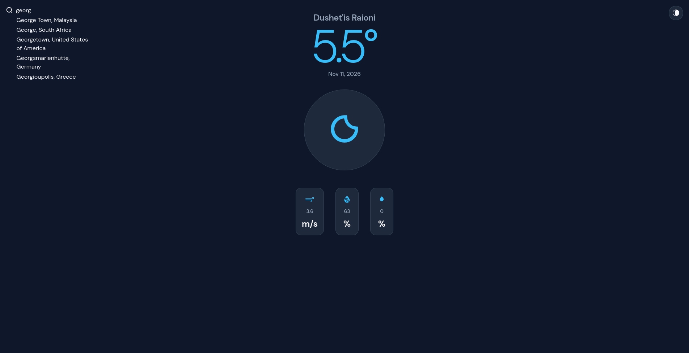

# Weather App

A responsive weather application built with **React, TypeScript, Vite, and Tailwind CSS**.



## Features

- Search weather by city or country.
- Get local weather using geolocation.
- Switch between light and dark themes.
- Responsive design.
- Real-time weather data.

## Tech Stack

- React
- TypeScript
- Vite
- Tailwind CSS
- [WeatherAPI](https://www.weatherapi.com/)

## Installation

1. Clone the repository:

   ```bash
   git clone https://github.com/ikamania/weather-app.git
   cd weather-app/app
   ```

2. Install dependencies:

   ```bash
   npm install
   ```

3. Create a `.env` file inside the `app/` directory:

   ```env
   VITE_WEATHER_API_KEY=your_api_key_here
   ```

   Get your API key from [WeatherAPI](https://www.weatherapi.com/).

4. Start the development server:

   ```bash
   npm run dev
   ```

## Build

```bash
npm run build
```
